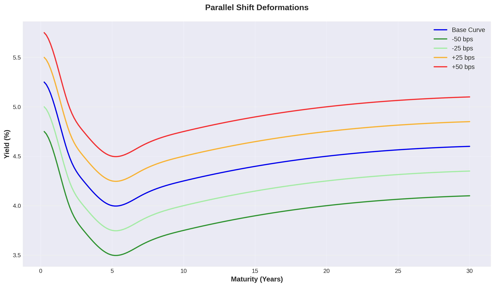
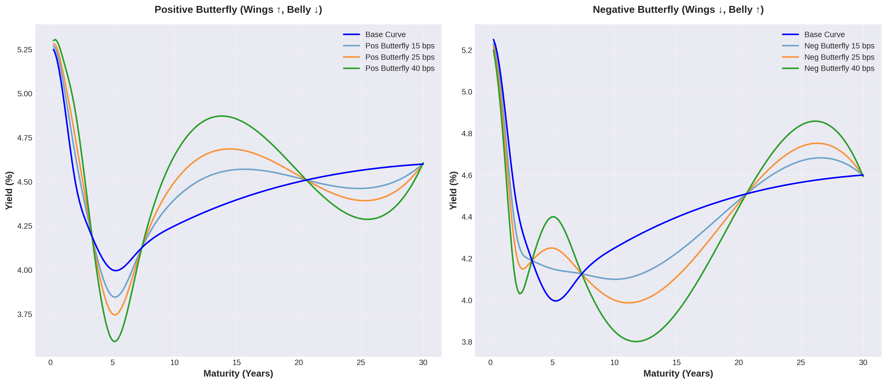
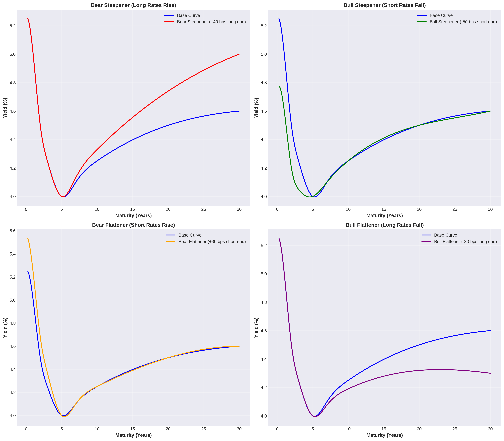
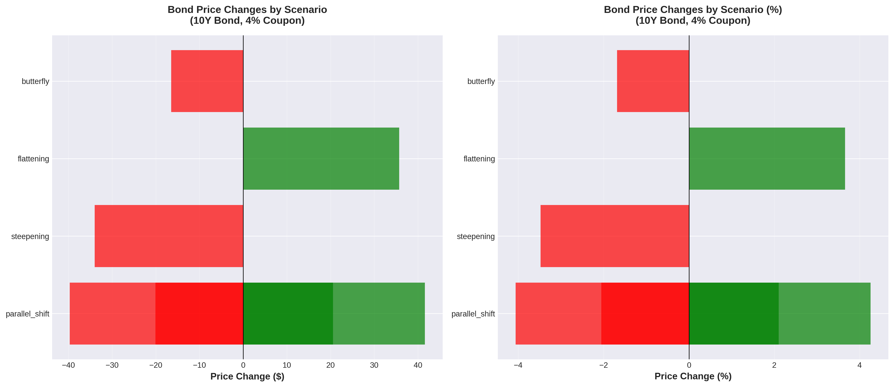
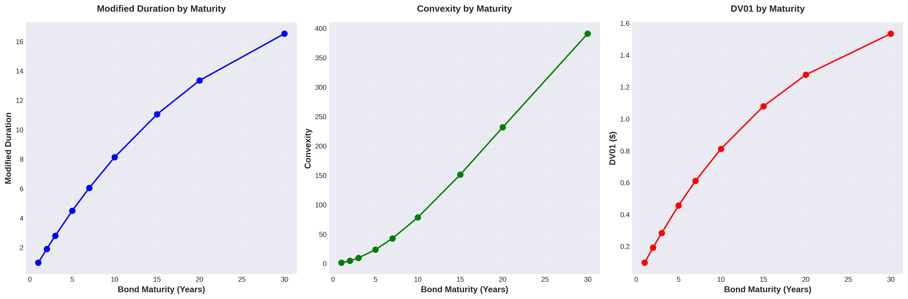
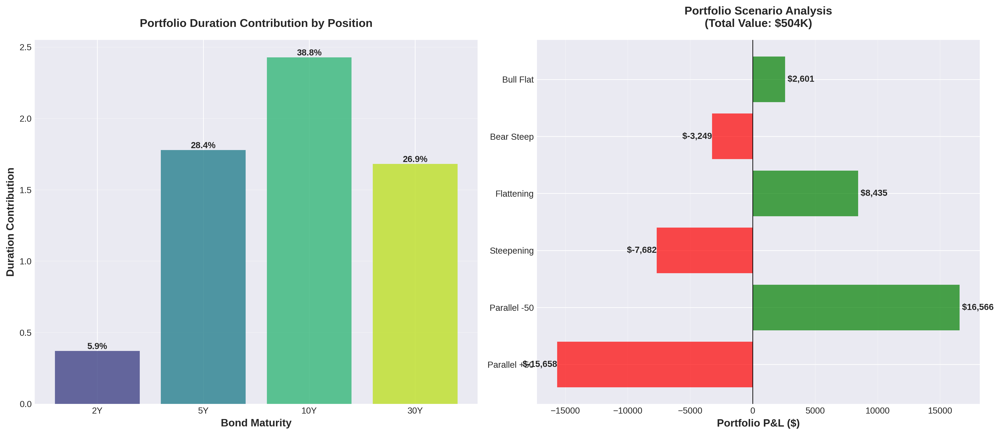

# Yield Curve Deformation Simulator

A Python toolkit for simulating yield curve movements and analyzing fixed income risk metrics. Supports parallel shifts, steepening, flattening, twists, and butterfly deformations with comprehensive duration, DV01, and convexity calculations.

## Detaillierte Skript-Dokumentation und Visualisierungen

Dieses Toolkit simuliert Zinsstrukturkurven-Bewegungen und berechnet umfassende Risikometriken für festverzinsliche Wertpapiere. Die folgenden Visualisierungen und Erklärungen zeigen, wie verschiedene Deformationen der Zinskurve funktionieren und welche Auswirkungen sie auf Anleihen und Portfolios haben.

## Features

- **Yield Curve Modeling**
  - Multiple interpolation methods (cubic spline, PCHIP, linear)
  - Forward rate and discount factor calculations
  - Par rate derivation
  - Slope and curvature analytics

- **Curve Deformations**
  - Parallel shifts
  - Steepening / Flattening
  - Twist movements
  - Butterfly spreads (positive and negative)
  - Bear/Bull steepener and flattener scenarios
  - PCA-based deformations (level, slope, curvature)
  - Custom point-by-point deformations

- **Risk Metrics**
  - Macaulay Duration
  - Modified Duration
  - Effective Duration
  - DV01 (Dollar Value of 01)
  - Convexity and Effective Convexity
  - Key Rate Durations
  - Partial Durations
  - Value at Risk (VaR)
  - Expected Shortfall

- **Portfolio Analytics**
  - Aggregate portfolio risk metrics
  - Duration contribution analysis
  - Scenario P&L attribution

### Visualisierungen und Interpretationen

#### 1. Basis-Zinskurve (Base Yield Curve)


**Was zeigt diese Visualisierung:**
- Die Basis-Zinskurve zeigt die Renditen für verschiedene Laufzeiten von 3 Monaten bis 30 Jahren
- Rote Punkte sind die ursprünglichen Marktdaten
- Die blaue Linie ist die kubische Spline-Interpolation zwischen den Datenpunkten

**Interpretation:**
- Die Kurve ist nahezu flach mit einer leicht inversen Form im kurzen Bereich (5.25% bei 3M → 4.00% bei 5Y)
- Die lange Ende steigt leicht an (4.00% bei 5Y → 4.60% bei 30Y)
- Der 2s10s Spread beträgt -0.25 bps, was auf eine sehr flache Kurve hinweist
- Diese Form deutet auf Markterwartungen stabiler oder sinkender Zinsen hin

---

#### 2. Parallele Verschiebung (Parallel Shift)



**Was zeigt diese Visualisierung:**
- Parallele Verschiebungen der gesamten Zinskurve um verschiedene Beträge (-50, -25, +25, +50 Basispunkte)
- Alle Laufzeiten werden um den gleichen Betrag verschoben

**Interpretation:**
- Grün (-50/-25 bps): Sinkende Zinsen → Anleihepreise steigen → Positiv für Anleiheinhaber
- Orange/Rot (+25/+50 bps): Steigende Zinsen → Anleihepreise fallen → Negativ für Anleiheinhaber
- Dies simuliert eine Zentralbankpolitik, die alle Zinsen gleichmäßig beeinflusst
- Relevant für Duration- und DV01-Berechnungen

---

#### 3. Versteilerung und Abflachung (Steepening & Flattening)


**Was zeigt diese Visualisierung:**
- **Links (Steepening)**: Kurze Zinsen fallen, lange Zinsen steigen → Kurve wird steiler
- **Rechts (Flattening)**: Kurze Zinsen steigen, lange Zinsen fallen → Kurve wird flacher

**Interpretation der Versteilerung (Steepening):**
- Die Zinskurve wird steiler, der Spread zwischen kurzen und langen Zinsen nimmt zu
- Typisch in wirtschaftlichen Erholungsphasen
- Short-Dated Bonds profitieren, Long-Dated Bonds verlieren
- Banken profitieren (können kurzfristig günstig leihen, langfristig teuer verleihen)

**Interpretation der Abflachung (Flattening):**
- Die Zinskurve wird flacher, der Spread nimmt ab
- Kann auf eine bevorstehende Rezession hindeuten
- Long-Dated Bonds profitieren relativ zu Short-Dated Bonds
- Typisch wenn Zentralbank Zinsen erhöht (kurzes Ende steigt schneller)

---

#### 4. Twist-Deformationen


**Was zeigt diese Visualisierung:**
- Unabhängige Bewegungen des kurzen und langen Endes der Zinskurve
- Pivot-Punkt bei 5 Jahren (graue gestrichelte Linie)
- Verschiedene Szenarien: kurzes Ende ↓/↑ während langes Ende ↑/↓

**Interpretation:**
- **Rot (Short -20, Long +30)**: Aggressivste Versteilerung → Kurzes Ende fällt stark, langes Ende steigt stark
- **Grün (Short +20, Long -30)**: Aggressivste Abflachung → Umgekehrte Bewegung
- **Lila (Short -30, Long +50)**: Extreme Versteilerung mit sehr starken Bewegungen
- Twist-Szenarien sind realistisch bei gemischten Zentralbank-Signalen oder Änderungen in Inflationserwartungen

---

#### 5. Butterfly-Spreads



**Was zeigt diese Visualisierung:**
- **Links (Positive Butterfly)**: Flügel steigen, Bauch sinkt → Kurve wird konvexer
- **Rechts (Negative Butterfly)**: Flügel fallen, Bauch steigt → Kurve wird konkaver

**Interpretation Positive Butterfly:**
- Kurz- und Langfristseite steigen, Mittelfristbereich fällt
- Die Kurve zeigt mehr Krümmung (höhere Curvature)
- Mittelfristige Anleihen (5-10Y) profitieren relativ
- Trading-Strategie: Long mittlere Laufzeiten, Short kurze und lange Laufzeiten

**Interpretation Negative Butterfly:**
- Mittelfristseite steigt, Flügel fallen
- Die Kurve wird glatter
- Kurz- und langfristige Anleihen profitieren
- Trading-Strategie: Short mittlere Laufzeiten, Long kurze und lange Laufzeiten

---

#### 6. Bear/Bull Szenarien



**Was zeigt diese Visualisierung:**
Vier makroökonomische Szenarien:

**Bear Steepener (oben links):**
- Langes Ende steigt (+40 bps)
- Kurzes Ende bleibt stabil
- **Interpretation**: Inflationserwartungen steigen, Wirtschaft überhitzt, lange Anleihen werden verkauft

**Bull Steepener (oben rechts):**
- Kurzes Ende fällt (-50 bps)
- Langes Ende bleibt stabil
- **Interpretation**: Zentralbank senkt Zinsen (Rezessionsangst), aber lange Zinsen bleiben stabil

**Bear Flattener (unten links):**
- Kurzes Ende steigt (+30 bps)
- Langes Ende bleibt stabil
- **Interpretation**: Zentralbank erhöht Zinsen aggressiv zur Inflationsbekämpfung

**Bull Flattener (unten rechts):**
- Langes Ende fällt (-30 bps)
- Kurzes Ende bleibt stabil
- **Interpretation**: Rezessionserwartungen, Flight-to-Quality in lange Staatsanleihen

---

#### 7. Key Rate Durations


**Was zeigt diese Visualisierung:**
- Sensitivität verschiedener Anleihen gegenüber Zinsänderungen an spezifischen Laufzeit-Punkten
- Vier verschiedene Anleihen: 2Y, 5Y, 10Y, 30Y

**Interpretation:**
- **2Y Bond (blau)**: Höchste Sensitivität bei 2Y Zinsen, kaum Sensitivität bei langen Zinsen
- **5Y Bond (grün)**: Breiter verteilt, Maximum bei 5Y
- **10Y Bond (rot)**: Sehr hohe Konzentration bei 10Y (Balken ~7.0), dominierender Faktor
- **30Y Bond (lila)**: Würde extreme Sensitivität bei 30Y zeigen (nicht vollständig sichtbar wegen Skalierung)

**Praktische Bedeutung:**
- Zeigt, welche Teile der Zinskurve das größte Risiko für eine Position darstellen
- Wichtig für Hedging-Strategien: Man kann gezielt Absicherungen an den relevanten Key Rates platzieren
- Portfolio-Manager nutzen dies zur Konstruktion von Immunisierungsstrategien

---

#### 8. Szenario-Analyse



**Was zeigt diese Visualisierung:**
- Preisänderungen einer 10-jährigen Anleihe (4% Kupon) unter verschiedenen Zinsszenarien
- Links: Absolute Preisänderung in Dollar
- Rechts: Prozentuale Preisänderung

**Interpretation der Szenarien:**
- **Parallel -50 bps** (grün): Größter Gewinn (~+$20.55, +2.1%) → Zinsen fallen stark
- **Parallel -25 bps** (grün): Moderater Gewinn → Zinsen fallen moderat
- **Parallel +25 bps** (rot): Moderater Verlust (~-$20.08, -2.05%) → Zinsen steigen moderat
- **Parallel +50 bps** (rot): Größerer Verlust → Zinsen steigen stark
- **Steepening** (rot): Verlust (~-$34, -3.48%) → Lange Zinsen steigen stark, trifft 10Y Bond hart
- **Flattening** (grün): Gewinn (~+$35.74, +3.66%) → Lange Zinsen fallen, sehr positiv für 10Y Bond
- **Butterfly** (rot): Moderater Verlust (~-$16.48, -1.69%) → Mittlere Laufzeiten leiden

**Praktische Bedeutung:**
- Zeigt das asymmetrische Risiko: Flattening bietet mehr Upside als Steepening Downside
- Wichtig für Risikomanagement und Value-at-Risk Berechnungen
- Hilft bei der Entscheidung, welche Positionen zu hedgen sind

---

#### 9. Duration und Konvexität nach Laufzeit



**Was zeigt diese Visualisierung:**
Drei zentrale Risikometriken über verschiedene Laufzeiten:

**Modified Duration (links):**
- Steigt von ~1 Jahr (bei 1Y Bond) auf ~15 Jahre (bei 30Y Bond)
- Nicht-lineares Wachstum: Flacher werdend bei längeren Laufzeiten
- **Interpretation**: Duration misst die prozentuale Preisänderung bei 1% Zinsänderung
  - 10Y Bond: ~8.14 Duration → Bei +1% Zinsen fällt Preis um ~8.14%
  - 30Y Bond: ~15 Duration → Bei +1% Zinsen fällt Preis um ~15%

**Convexity (Mitte):**
- Steigt exponentiell von ~5 (bei 1Y) auf ~350 (bei 30Y)
- Stark beschleunigtes Wachstum bei langen Laufzeiten
- **Interpretation**: Convexity misst die Krümmung der Preis-Rendite-Beziehung
  - Positive Convexity ist vorteilhaft: Preise steigen mehr bei fallenden Zinsen als sie bei steigenden Zinsen fallen
  - Je höher die Convexity, desto besser die asymmetrische Payoff-Struktur

**DV01 (rechts):**
- Dollar Value of 01 Basis Point
- Steigt von ~$0.10 (bei 1Y) auf ~$1.50 (bei 30Y)
- **Interpretation**: Direkter Dollar-Verlust bei 1 Basispunkt Zinsanstieg
  - 10Y Bond: ~$0.81 DV01 → Bei +1bp verliert die $1000 Anleihe $0.81
  - 30Y Bond: ~$1.50 DV01 → Höheres absolutes Risiko

**Praktische Bedeutung:**
- Portfolio-Manager nutzen diese Metriken zur Risikosteuerung
- Lange Anleihen haben höheres Zinsrisiko aber auch höhere Convexity-Vorteile
- Trade-off zwischen Rendite-Pick-up und Zinsrisiko

---

#### 10. Portfolio-Analyse



**Was zeigt diese Visualisierung:**
Ein Portfolio mit vier Positionen (Gesamtwert ~$504K):
- 100x 2Y Bonds (3.5% Kupon)
- 200x 5Y Bonds (4.0% Kupon)
- 150x 10Y Bonds (4.5% Kupon)
- 50x 30Y Bonds (5.0% Kupon)

**Links - Duration Contribution:**
- **2Y Bond**: 0.37 Duration (5.9% des Gesamt-Risikos) → Geringster Beitrag
- **5Y Bond**: 1.78 Duration (28.4%) → Zweitgrößter Beitrag
- **10Y Bond**: 2.43 Duration (38.8%) → Größter Risikobeitrag trotz mittlerer Gewichtung
- **30Y Bond**: 1.68 Duration (26.9%) → Hohe Duration aber niedrige Stückzahl

**Interpretation:**
- Die 10Y Position dominiert das Zinsrisiko des Portfolios
- Trotz kleinerer Stückzahl als 5Y Bonds hat 10Y mehr als doppelte Duration-Contribution
- Portfolio ist "bullet"-artig um 10Y zentriert

**Rechts - Scenario P&L:**
Verschiedene Zinsszenarien und ihre Portfolio-Auswirkungen:
- **Parallel +50** (rot): ~-$10.7K Verlust → Steigende Zinsen schaden Portfolio
- **Parallel -50** (grün): ~+$10.9K Gewinn → Fallende Zinsen helfen Portfolio
- **Steepening** (rot): ~-$7.7K Verlust → Long-End steigt, schadet 10Y und 30Y Positionen stark
- **Flattening** (grün): ~+$8.0K Gewinn → Long-End fällt, hilft 10Y und 30Y Positionen
- **Bear Steep** (rot): ~-$3.7K Verlust → Moderater Verlust durch steigende lange Zinsen
- **Bull Flat** (grün): ~+$2.7K Gewinn → Moderater Gewinn durch fallende lange Zinsen

**Interpretation:**
- Portfolio ist lang positioniert (profitiert von fallenden Zinsen)
- Asymmetrisches Profil: Flattening bietet mehr Upside als Steepening Downside
- Steepening ist das gefährlichste Szenario nach parallelem Zinsanstieg
- Das Portfolio würde von einer Rezession (Bull Flattening) profitieren

---

## Zusammenfassung: Was macht das Skript?

Das `basic_usage.py` Skript demonstriert die Kernfunktionalität des Yield Curve Simulators:

1. **Zinskurven-Modellierung**: Erstellt eine realistische Zinskurve mit kubischer Spline-Interpolation
2. **Deformations-Szenarien**: Simuliert 7 verschiedene Arten von Zinskurven-Bewegungen
3. **Einzelwert-Risikometriken**: Berechnet Duration, Convexity, DV01, Key Rate Durations für Anleihen
4. **Szenario-Analyse**: Evaluiert Preisänderungen unter verschiedenen Zinsszenarien
5. **Portfolio-Risiko**: Aggregiert Risikometriken über mehrere Positionen und berechnet Scenario P&L
6. **Value-at-Risk**: Berechnet VaR und Expected Shortfall basierend auf Volatilitätsannahmen

### Hauptanwendungsfälle:

- **Risk Management**: Quantifizierung von Zinsrisiken in Bond-Portfolios
- **Trading**: Bewertung von Curve-Trading-Strategien (Steepener, Flattener, Butterfly)
- **Hedging**: Identifikation der wichtigsten Risikoquellen durch Key Rate Durations
- **Stresstesting**: Simulation extremer Zinsszenarien und deren Portfolio-Auswirkungen
- **Portfolio-Konstruktion**: Optimierung der Duration- und Convexity-Profile

Das Toolkit ist besonders wertvoll für Fixed-Income Portfolio Manager, Risikomanager und Trader, die ein tiefes Verständnis der Zinskurven-Dynamik und ihrer Auswirkungen auf Anleiheportfolios benötigen.

---

## Installation

```bash
pip install -r requirements.txt
```

## Visualisierungen generieren

```bash
cd examples
python visualize_curves.py
```

Die Visualisierungen werden in `docs/images/` gespeichert.

## Quick Start

```python
import numpy as np
from yield_curve import YieldCurve, CurveDeformer, RiskCalculator, Bond

# Create a yield curve
tenors = np.array([0.25, 0.5, 1, 2, 3, 5, 7, 10, 20, 30])
rates = np.array([5.25, 5.20, 5.00, 4.50, 4.25, 4.00, 4.10, 4.25, 4.50, 4.60])
curve = YieldCurve(tenors, rates)

# Apply deformations
deformer = CurveDeformer(curve)
steep_result = deformer.steepening(50)  # 50 bps steepening
flat_result = deformer.flattening(25)   # 25 bps flattening
butterfly = deformer.positive_butterfly(25)  # Wings up, belly down

# Create a bond and calculate risk metrics
bond = Bond(face_value=1000, coupon_rate=4.0, maturity=10, frequency=2)
risk_calc = RiskCalculator(curve)
metrics = risk_calc.calculate_metrics(bond)

print(f"Modified Duration: {metrics.modified_duration:.4f}")
print(f"DV01: ${metrics.dv01:.4f}")
print(f"Convexity: {metrics.convexity:.4f}")
```

## Curve Deformations

### Parallel Shift
```python
result = deformer.parallel_shift(25)  # +25 bps across all tenors
```

### Steepening / Flattening
```python
# Steepening: short rates down, long rates up
result = deformer.steepening(magnitude_bps=50, pivot_tenor=5.0)

# Flattening: short rates up, long rates down
result = deformer.flattening(magnitude_bps=50, pivot_tenor=5.0)
```

### Twist
```python
# Independent control of short and long end movements
result = deformer.twist(short_shift_bps=-20, long_shift_bps=30, pivot_tenor=5.0)
```

### Butterfly
```python
# Positive butterfly: wings up, belly down
result = deformer.butterfly(wings_shift_bps=25, body_shift_bps=-25)

# Convenience methods
result = deformer.positive_butterfly(25)
result = deformer.negative_butterfly(25)
```

### Bear/Bull Scenarios
```python
# Bear steepener: long end rates rise
result = deformer.bear_steepener(long_end_shift_bps=40)

# Bull steepener: short end rates fall
result = deformer.bull_steepener(short_end_shift_bps=50)

# Bear flattener: short end rates rise
result = deformer.bear_flattener(short_end_shift_bps=30)

# Bull flattener: long end rates fall
result = deformer.bull_flattener(long_end_shift_bps=30)
```

## Risk Metrics

### Single Bond Analysis
```python
risk_calc = RiskCalculator(curve)
metrics = risk_calc.calculate_metrics(bond)

# Access individual metrics
print(f"Macaulay Duration: {metrics.macaulay_duration:.4f} years")
print(f"Modified Duration: {metrics.modified_duration:.4f}")
print(f"Effective Duration: {metrics.effective_duration:.4f}")
print(f"DV01: ${metrics.dv01:.4f}")
print(f"Convexity: {metrics.convexity:.4f}")

# Price change estimate
pct_change = metrics.price_change_estimate(yield_change_bps=50)
```

### Key Rate Durations
```python
krds = risk_calc.key_rate_durations(bond)
for tenor, krd in krds.to_dict().items():
    print(f"{tenor}Y: {krd:.4f}")
```

### Portfolio Analysis
```python
from yield_curve.bond import BondPortfolio
from yield_curve.risk_metrics import PortfolioRiskCalculator

portfolio = BondPortfolio()
portfolio.add_position(Bond(1000, 3.5, 2, 2), quantity=100)
portfolio.add_position(Bond(1000, 4.0, 5, 2), quantity=200)
portfolio.add_position(Bond(1000, 4.5, 10, 2), quantity=150)

port_risk = PortfolioRiskCalculator(curve, portfolio)
port_metrics = port_risk.portfolio_metrics()

print(f"Portfolio Duration: {port_metrics.modified_duration:.4f}")
print(f"Portfolio DV01: ${port_metrics.dv01:.4f}")
```

## Scenario Analysis

```python
scenarios = [
    {"type": "parallel_shift", "shift_bps": 25},
    {"type": "steepening", "magnitude_bps": 50},
    {"type": "butterfly", "wings_shift_bps": 25, "body_shift_bps": -25},
]

results = deformer.scenario_analysis(scenarios)
scenario_risks = risk_calc.scenario_analysis(bond, results)

for risk in scenario_risks:
    print(f"{risk.scenario_name}: {risk.price_change_pct:.4f}%")
```

## API Reference

### YieldCurve
- `rate_at(tenor)` - Get interpolated rate at any tenor
- `forward_rate(t1, t2)` - Calculate forward rate between two times
- `discount_factor(t)` - Get discount factor at time t
- `par_rate(maturity)` - Calculate par rate for given maturity
- `slope(short, long)` - Calculate curve slope
- `curvature(short, mid, long)` - Calculate curve curvature
- `shift(bps)` - Create parallel-shifted curve

### CurveDeformer
- `parallel_shift(shift_bps)`
- `steepening(magnitude_bps, pivot_tenor)`
- `flattening(magnitude_bps, pivot_tenor)`
- `twist(short_shift_bps, long_shift_bps, pivot_tenor)`
- `butterfly(wings_shift_bps, body_shift_bps)`
- `bear_steepener(long_end_shift_bps)`
- `bull_steepener(short_end_shift_bps)`
- `bear_flattener(short_end_shift_bps)`
- `bull_flattener(long_end_shift_bps)`
- `pca_deformation(level, slope, curvature)`
- `custom_deformation(tenor_shifts)`
- `scenario_analysis(scenarios)`

### RiskCalculator
- `calculate_metrics(bond)` - Returns RiskMetrics dataclass
- `key_rate_durations(bond, key_tenors)`
- `partial_durations(bond)`
- `scenario_analysis(bond, deformation_results)`
- `value_at_risk(bond, yield_vol, confidence, holding_period)`
- `expected_shortfall(bond, yield_vol, confidence, holding_period)`

### Bond
- `price(curve)` - Calculate bond price from yield curve
- `price_from_yield(ytm)` - Calculate price from yield to maturity
- `yield_to_maturity(price)` - Solve for YTM given price
- `current_yield(price)` - Calculate current yield

## Examples

See the `examples/` directory for comprehensive usage examples:
- `basic_usage.py` - Full demonstration of all features

## License

MIT License
